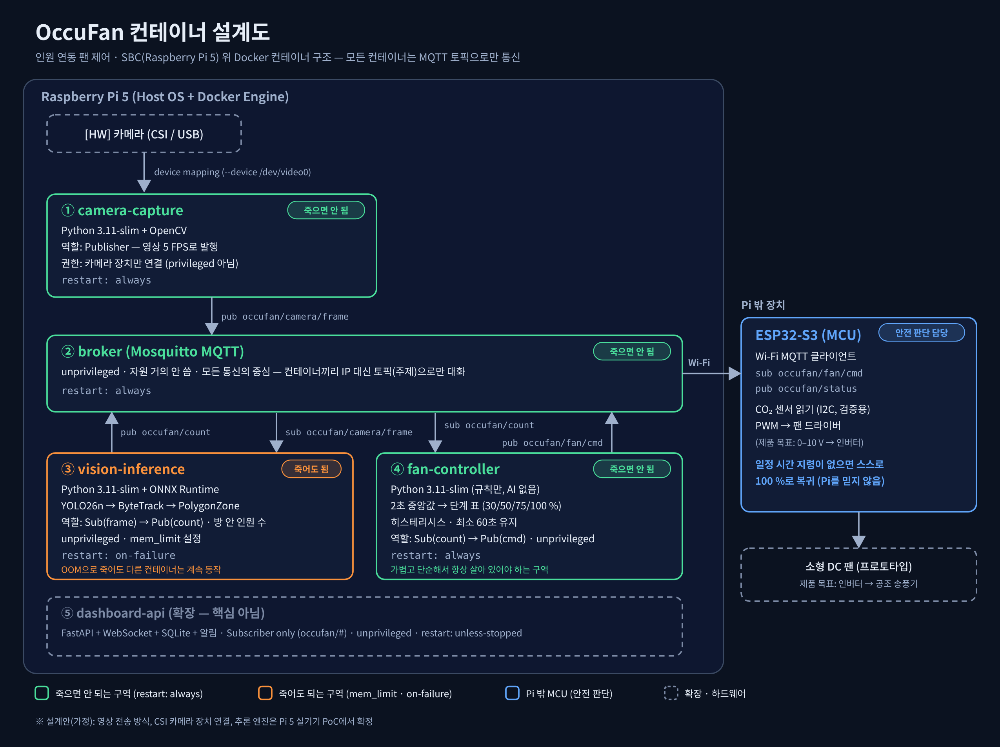

# OccuFan SBC 컨테이너 구조 보고서

## 1. 개요

Raspberry Pi 5 위에서 Docker 컨테이너 4개(+확장 1개)가 MQTT 토픽으로만 통신한다. 안전 판단은 Pi 밖의 ESP32-S3가 맡는다. 이 문서는 구현 전 설계안이며, 값과 설정은 PoC에서 조정한다.

## 2. 설계 원칙

1. **죽어도 되는 AI와 죽으면 안 되는 규칙을 컨테이너로 분리한다.** 메모리 부족으로 AI 컨테이너가 죽어도 규칙 컨테이너는 계속 동작한다.
2. **안전 판단은 MCU가 한다.** Pi가 멈춰도 ESP32-S3가 일정 시간 지령이 없으면 스스로 100 %로 복귀한다.
3. **컨테이너끼리는 IP가 아니라 MQTT 토픽으로만 통신한다.** 컨테이너를 추가하거나 바꿔도 다른 컨테이너를 고치지 않는다.
4. **권한을 최소화한다.** 카메라 장치는 camera-capture만 연결하고, 나머지는 권한 없이(unprivileged) 둔다.

## 3. 컨테이너 구성

| 컨테이너 | 역할 | 기술 | 권한 | restart | 구분 |
|---|---|---|---|---|---|
| ① camera-capture | 카메라 영상을 5 FPS로 발행 | Python 3.11-slim, OpenCV | 카메라 장치만 연결 | always | 죽으면 안 됨 |
| ② broker | 모든 메시지 중계 | Mosquitto | unprivileged | always | 죽으면 안 됨 |
| ③ vision-inference | 사람 검출·추적·영역 카운트로 방 안 인원 수 계산 | Python 3.11-slim, ONNX Runtime, YOLO26n, ByteTrack, PolygonZone | unprivileged, mem_limit | on-failure | 죽어도 됨 |
| ④ fan-controller | 2초 중앙값 → 단계 표(30/50/75/100 %) → 히스테리시스·최소 60초 유지 → 지령 | Python 3.11-slim (규칙만, AI 없음) | unprivileged | always | 죽으면 안 됨 |
| ⑤ dashboard-api (확장) | 기록·화면·알림 | FastAPI, WebSocket, SQLite | unprivileged | unless-stopped | 확장 (핵심 아님) |

## 4. MQTT 토픽

| 토픽 | 발행 | 구독 | 내용 |
|---|---|---|---|
| occufan/camera/frame | ① camera-capture | ③ vision-inference | 축소한 영상 (5 FPS) |
| occufan/count | ③ vision-inference | ④ fan-controller, ⑤ | 방 안 인원 수 |
| occufan/fan/cmd | ④ fan-controller | ESP32-S3, ⑤ | 팬 단계 지령 |
| occufan/status | ESP32-S3 | ⑤ dashboard-api | 장치 상태 |

## 5. 데이터 흐름

카메라 → ① → (frame) → ② broker → ③ → (count) → ② → ④ → (cmd) → ② → Wi-Fi MQTT → ESP32-S3 → PWM → 팬

## 6. 컨테이너가 죽으면 (장애 시나리오)

| 상황 | 일어나는 일 | 결과 |
|---|---|---|
| ① 중단 | 영상이 끊겨 ③이 인원 수를 내지 못함 | ④가 지령을 멈추거나 100 %를 보내고, ESP32-S3가 100 %로 복귀. ①은 자동 재시작 |
| ② 중단 | 모든 통신이 끊김 | ESP32-S3가 일정 시간 뒤 100 %로 복귀. ②는 자동 재시작 |
| ③ 중단 (메모리 부족 등) | 인원 수가 끊김 | 위와 같이 100 % 복귀. 다른 컨테이너는 계속 동작하고 ③만 재시작 |
| ④ 중단 | 지령이 끊김 | ESP32-S3가 100 %로 복귀. ④는 자동 재시작 |
| ⑤ 중단 | 기록·알림만 멈춤 | 팬 제어에는 영향 없음 |
| Pi 전체 중단 | 모든 지령이 끊김 | ESP32-S3가 스스로 100 %로 복귀 |

**규칙**: ④는 인원 수가 일정 시간 갱신되지 않으면 마지막 단계를 계속 보내지 않고, 지령을 멈추거나 100 %를 보낸다. 그래야 ③이 죽었을 때 ESP32-S3가 이상을 알아챌 수 있다. 일정 시간(N초)은 PoC에서 정한다.

## 7. 한계와 확인할 것 (가정)
- 영상을 MQTT로 보내는 방식이 Pi 5에서 충분히 빠른지 확인하지 못했다. 부하가 크면 ①과 ③을 합치는 방안을 검토한다.
- Pi 5의 CSI 카메라를 컨테이너에 연결하는 방법은 실기기에서 확인해야 한다.
- 추론 엔진은 엔진 비교 결과와 Pi 5 실측 후 확정한다.
- 베이스 이미지, 권한, restart, mem_limit 값은 설계안이며 구현하며 조정한다.
- 이 설계는 실제로 실행해 보지 않은 계획이다.